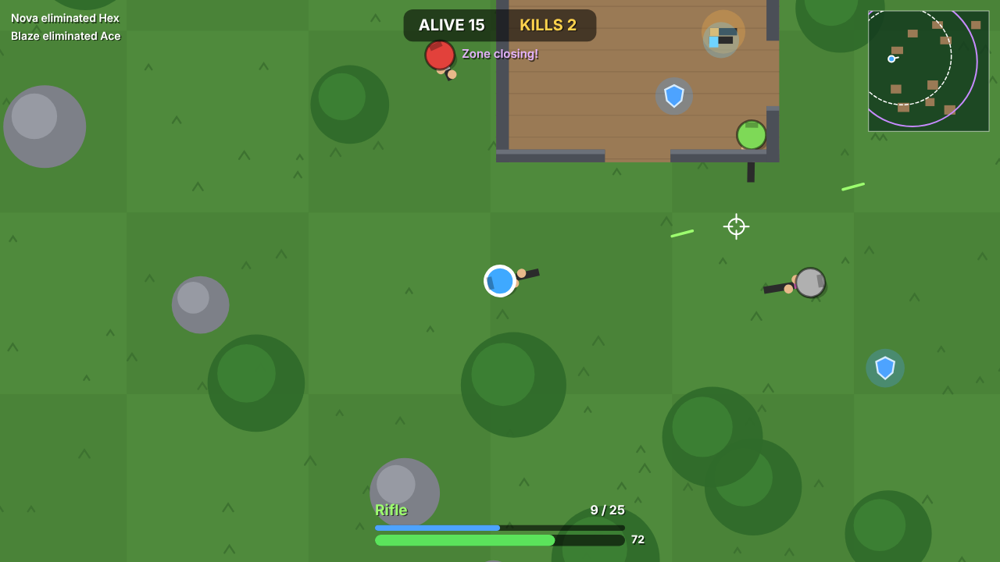

# 🎯 Last Zone

A top-down 2D battle royale that runs in the browser. 20 fighters drop onto an island. Loot weapons and gear, stay inside the shrinking safe zone, and be the last one standing.

**▶ [Play it here](https://mohamedniaba917-lang.github.io/last-zone/)** · no download needed, works on phone and computer

## Controls

| | Computer | Phone / tablet |
|---|---|---|
| Move | WASD or arrow keys | Left thumb (virtual joystick) |
| Aim | Mouse | Right thumb |
| Shoot | Hold left click | Push the right joystick past halfway |
| Reload | R | Automatic when empty |

Play phones in landscape for the best view.

## How it works
- **The zone:** a purple storm closes in over six phases. The dashed white circle on the map shows where the next safe zone will be. Standing outside hurts, and it hurts more every phase.
- **Loot:** walk over items to pick them up. Better weapons replace worse ones automatically.
  - Weapons, weakest to strongest: Pistol → SMG → Shotgun → Rifle → Sniper
  - 🩹 Medkit: +50 health
  - 🛡️ Armour: +50, absorbs most bullet damage
- **Eliminated fighters** drop their weapon and a medkit.
- **Hide under trees:** bots can't spot you from far away when you're under a canopy.

## Features
- 19 computer opponents with their own AI: they loot, rotate to the safe zone, pick targets they can actually see, strafe, keep a sensible range for their weapon, and fight each other as well as you
- 5 weapons with different damage, fire rate, spread, magazine size, reload time and range (the shotgun fires 7 pellets)
- Randomly generated map every match: houses with doorways, rocks, trees and loot
- Line-of-sight checks so walls and rocks block vision and bullets
- Shrinking zone with phases, minimap, kill feed, health/armour bars, ammo and reload display
- Camera follow with screen shake, muzzle flashes, hit markers and particles
- Works with keyboard + mouse or touch screen (dual virtual joysticks)
- Stats saved in the browser: wins, total eliminations, best placement

## How it's built
- **HTML5 Canvas** and **plain JavaScript**, no libraries or game engine
- **Collision detection:** circle-vs-circle (players, rocks, trees) and circle-vs-rectangle (walls)
- **Bullets** are checked as line segments each frame so fast shots can't skip through walls or players
- **Line of sight** uses segment-vs-rectangle (Liang–Barsky) and segment-vs-circle tests
- **Bot AI** is a simple decision loop that "thinks" a few times a second: find a visible target → fight; otherwise head for loot or the safe zone; wiggle free if stuck
- The camera uses a canvas transform, and only objects on screen are drawn

## Run it locally
Download or clone the repo and open `index.html` in any modern browser.

## Ideas for future updates
- Weapon inventory with two slots and dropping weapons
- Vehicles or a jump-in plane at the start
- Online multiplayer

---
Made by **Mohamed** · [More of my games](https://github.com/mohamedniaba917-lang)
